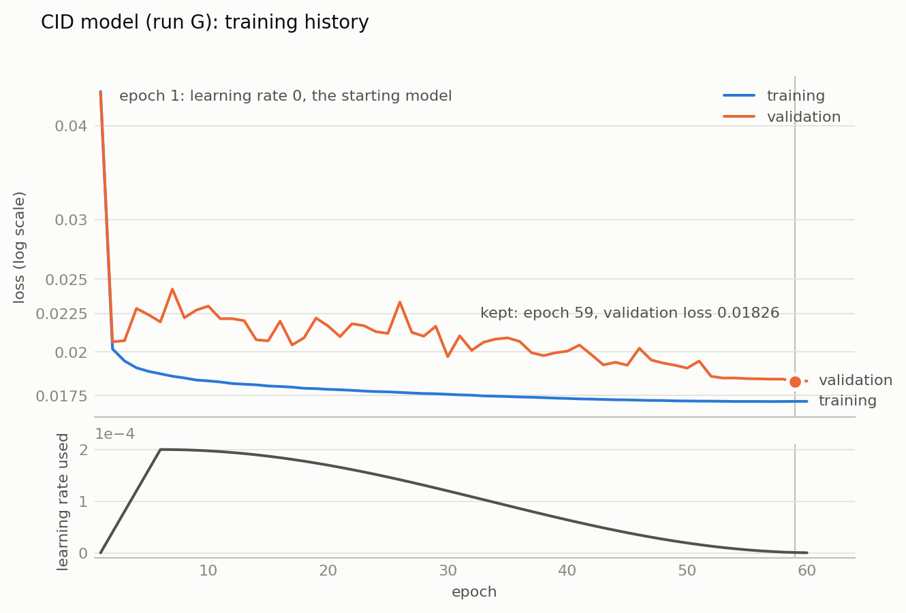
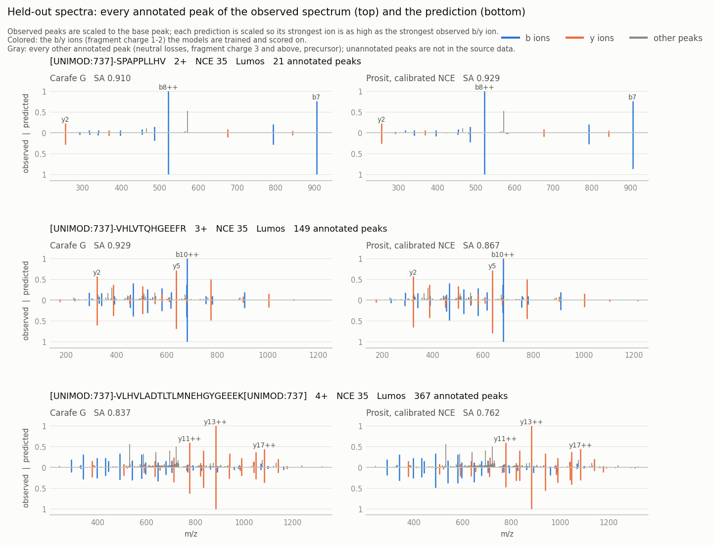

# TMT CID MS2 model from PROSPECT PTMs: TMT

This folder builds a TMT MS2 model for **CID fragmentation with ion-trap (ITMS) read-out** from
public, annotated spectra, and holds everything needed to reproduce it: data download and checks,
conversion, the check of the conversion, training, tuning, evaluation and a comparison with
the Prosit_2020_intensity_TMT model served by Koina. It follows [../ms2hcd/](../ms2hcd/README.md),
which builds the HCD model, and reuses its training, tuning, scoring and plotting scripts. Every
number below comes from `run_ms2cid.sh`'s output in one working directory that started empty (the
script resumes where it stopped; this run was completed in eight invocations: the full pipeline
with runs A-F (its final steps for the default selection, run D), the final steps for the best of
A-F, run G added to `tune_configs.tsv` and trained alone, the final steps for G, step 10 again to
redraw the loss curve with the options described under the figure, run H added to
`tune_configs.tsv` and trained alone, step 10 again to draw run H's loss curve, and step 10 again
to draw runs G and H on one figure in its place).

## Data sources

| | |
|---|---|
| spectra | PROSPECT PTMs: TMT, [Zenodo record 8221499](https://zenodo.org/records/8221499), CC BY 4.0 |
| files | 22 files (11 pools, each a `<pool>_meta_data.parquet` and a `<pool>.zip`), 36,624,448,836 bytes |
| checksums | MD5 of every file in `prospect_checksums.txt`; the downloader refuses a mismatch and a changed record |
| split | Supplementary Table 1 of Gabriel et al., *Prosit-TMT: Deep Learning Boosts Identification of TMT-Labeled Peptides*, Anal. Chem. 2022, 94, 7181-7190 ([doi:10.1021/acs.analchem.1c05435](https://doi.org/10.1021/acs.analchem.1c05435)), file `ac1c05435_si_001.xlsx`, SHA-256 in `prosit_tmt_si_checksum.txt` |

PROSPECT PTMs: TMT ([PROSPECT project page](https://wilhelm-lab.github.io/PROSPECT/)) holds, per
pool, one metadata row per spectrum (among other columns: raw file, scan, ProForma sequence,
precursor charge, fragmentation, mass analyser, collision energy (`orig_collision_energy`),
Andromeda score) and one row per peak annotation (ion type, ion number, charge, observed and
theoretical m/z, intensity, neutral loss, `fragment_score`); a peak with several annotations has
several rows. Its raw files largely overlap those listed in the Prosit-TMT supplementary table (see
below). The supplementary table assigns peptide sequences to train, validation and hold_out sets;
the sequences it labels hold_out are the test set here. The table is downloaded from the article
page and passed to the driver.

## What the dataset contains

From `prospect_stats.py` (all pools, before any filtering):

| property | value |
|---|---|
| spectra / raw files | 28,203,227 / 2,311 |
| fragmentation / analyser | HCD/FTMS 21,393,414; CID/ITMS 6,605,173; HCD/ITMS 204,640 |
| TMT label | full (peptide N-terminus and every lysine) 23,885,798; partial 379,973; none 3,937,456 |
| CID/ITMS collision energy | 35 for all 6,605,173 |
| CID/ITMS by label | full 5,670,303; partial 125,751; none 809,119 |

"Full" is TMT6plex on the peptide N-terminus and on every lysine (a peptide without lysine needs
only the N-terminal label); "partial" has at least one TMT6plex but misses it on the N-terminus or
on a lysine; "none" has no TMT6plex. Only fully labelled spectra are converted to training data.

The fully labelled CID/ITMS spectra:

| property | value |
|---|---|
| spectra | 5,670,303 |
| sequences / modified peptides / peptide ions (modified sequence, charge) | 509,723 / 560,716 / 642,326 |
| precursor charge | 1: 224,949; 2: 3,711,387; 3: 1,560,052; 4: 173,855; 5: 60 |
| peptide length | 7-38 (1,135 spectra longer than 30) |
| spectra per peptide ion | median 5, mean 8.83, max 9,572 |
| Andromeda score | minimum 40.0, median 95.1 |
| modifications | TMT6plex, carbamidomethyl C (every cysteine), oxidised M (809,282 spectra) |

**Compared with the Prosit-TMT supplementary table.** The table lists one PSM per unmodified
sequence (621,103 rows), of which 289,111 are CID/ITMS; that counts sequences, not CID spectra.
262,775 of those sequences have fully labelled CID spectra in PROSPECT; 519,249 of the table's
621,103 PSM scans (and 242,452 of its 289,111 CID scans) are in PROSPECT by raw file and scan
number; 2,165 of the table's 2,394 raw files are. By the table's split, the sequences of
PROSPECT's fully labelled CID spectra are train 291,911, validation 77,898, hold_out 36,658 and
not in the split 103,256.

## Conversion to training data

`prospect_to_carafe_training.py` keeps CID spectra read in the ion trap whose peptide carries
TMT6plex on the N-terminus and on every lysine, and writes the two files Carafe's `ai.py` trains
from: `psm_pdv.txt` (one row per spectrum, with NCE, instrument, raw file and scan) and
`fragment_intensity_df.tsv` (`b_z1, b_z2, y_z1, y_z2` per backbone position, each spectrum scaled
to a maximum of 1). Modifications are parsed from ProForma: `[UNIMOD:737]-` is TMT6plex on the
N-terminus, `K[UNIMOD:737]` on lysine, `C[UNIMOD:4]` carbamidomethyl, `M[UNIMOD:35]` oxidation;
anything else would be dropped (none was).

A peak can carry several annotations (for example y2 at charge 1, and b5 at charge 3 with a loss of
CH4O-NH3, at the same m/z). Each peak takes the annotation with the highest `fragment_score`, which
PROSPECT's data description
([`zenodo-README.md`](https://github.com/wilhelm-lab/PROSPECT/blob/main/zenodo-README.md)) calls a
score "to solve collisions"; in every annotation file of the two smallest pools
(`TMT_TUM_third_pool` and `TMT_TUM_missing_first`: 51 files, 464,494 spectra) it ranks a precursor
reading highest (166-200), then b/y ions without neutral loss by fragment charge (100 at charge 1,
99 at 2, 98 at 3), then b/y readings with a neutral loss (38-95). The first listed wins a tie (so
when a clean b and a clean y reading tie, the first listed receives the intensity). A peak whose
reading is a b or y ion with no neutral loss at fragment charge 1 or 2 fills that ion's cell; if
several peaks fill one cell, the most intense is kept.

In those files, every intensity is a multiple of 0.01 and none is below 0.01, so the weakest
recorded peak is 0.01 and weak ions are coarsely quantized. The values are normalized, but PROSPECT
does not document to what: of the 463,766 spectra with a peak read as a b or y ion, the strongest
such peak is 1.00 in 450,049, above 1.00 in 13,717 and below 1.00 in none. PROSPECT does not record
the instrument per spectrum; every spectrum is given the instrument category `Lumos` (Carafe's MS2
model takes one of the categories Lumos, QE, timsTOF, SciexTOF and ThermoTOF, and not the mass
analyser), and its collision energy (35) as NCE.

| | |
|---|---|
| CID/ITMS spectra | 6,605,173 |
| dropped: not fully TMT labelled | 934,870 |
| dropped: unexpected modification, duplicate scan, no annotation | 0, 0, 0 |
| dropped: no clean b/y ion at fragment charge 1-2 | 5,208 |
| **spectra kept** | **5,665,095** from 1,152 raw files, 61,201,817 fragment rows |
| precursor charge | 1: 224,948; 2: 3,707,749; 3: 1,558,500; 4: 173,838; 5: 60 |

**Check** (`verify_prospect_conversion.py`). A wrong sequence, modification position, fragment row
or charge column would still give a plausible-looking file, so a random sample of spectra is
rebuilt from its annotations by a separate, deliberately plain implementation of the rules, and
every populated cell's theoretical m/z from AlphaBase (from the sequence and modifications
written) is compared with the theoretical m/z PROSPECT stored for the annotation the intensity
came from (a wrong modification position would shift a TMT-bearing fragment by 229 Da).

| | |
|---|---|
| layout | 5,665,095 spectra tile 61,201,817 fragment rows contiguously |
| spectra checked | 2,000 (random, seed 2024) from 760 raw files; 0 differ from the rebuild |
| cells checked | 44,121, none without a source annotation |
| AlphaBase vs PROSPECT theoretical m/z | median 0.0208 ppm, max 0.0608 ppm |
| observed vs AlphaBase m/z | median +0.029 Da, 99% within 0.473 Da (ion trap) |

## Evaluation protocol

`split_prosit_holdout.py` holds out every spectrum whose sequence the supplementary table labels
hold_out, so the Carafe models are scored on peptides they did not train on. Of the remaining
sequences, 1% (seed 2024) is set aside as the validation set that chooses the best epoch; the
rest is training data.

| part | spectra | sequences |
|---|---|---|
| training | 5,210,435 | 468,207 |
| validation | 51,848 | 4,729 |
| **held-out test set** (the table's hold_out) | **402,812** | **36,655** |

(36,655 rather than the 36,658 hold_out sequences above: dropping the 5,208 spectra with no clean
b/y ion removed three hold_out sequences, and 132 sequences in all.)

The training spectra come from sequences the table labels train (3,495,418) or validation
(865,424), and from sequences not in the table's split (849,593).

The held-out set is only used to score finished models, never to choose an epoch or a setting.
Scores are medians over the 402,812 held-out spectra of Pearson correlation (PCC), cosine (COS),
spectral angle score (SA), Spearman correlation (SPC), plus the share of spectra with SA > 0.9,
computed with Carafe's `models.py` (`../ms2hcd/evaluate_heldout.py`), each spectrum predicted at
its own NCE and instrument; the last SA column below is over the 392,148 held-out spectra inside
Carafe's default library range (length 7-35, precursor charge 2-4). Every held-out peptide has
7-30 residues, so that column only leaves out the 10,664 spectra at precursor charge 1. All other
scores, including the comparison with Prosit, use all 402,812 held-out spectra, charge 1 included
(the per-charge tables split them by precursor charge).

References on the held-out set: the installed generic AlphaPeptDeep model, PCC 0.3827, COS 0.4449,
**SA 0.2935**, SPC 0.5937, SA > 0.9 for 0.0% of spectra; the HCD TMT model (`models/ms2tmt.pt`,
from `../ms2hcd`), PCC 0.7868, COS 0.8126, **SA 0.6039**, SPC 0.8163, 0.2%.

## Training

Training runs Carafe's `src/main/resources/py/v2/ai.py` through `../ms2hcd/train_tmt_ms2.py`, as for
the HCD model: transfer learning from a starting model, a warmup followed by cosine decay of the
learning rate, and the weights of the epoch with the lowest validation loss kept. Two things
differ from the HCD model:

- **A separate validation set** (`ai.py --valid_dir`, an opt-in option). Without it, `ai.py`
  trains on a random sample of the spectra that leaves out about 5,000 of them (`train_tmt_ms2.py`
  passes `--ms2_max_test_samples 5000`) and validates only on spectra whose sequence is not in the
  sample, so a sequence can be validated on only if every one of its spectra was left out; if none
  is, `ai.py` validates on all spectra, training spectra included. With `--valid_dir`, all
  5,210,435 training spectra are trained on and the 51,848 validation spectra are the validation
  set. The training loop batches each peptide length separately, so at batch size 512 an epoch has
  10,194 steps (`ai.py` logs 10,177, which is 5,210,435 / 512 without the grouping by length).
- **Two starting models**: the generic AlphaPeptDeep model and the HCD TMT model; run H starts
  from random initialization.

Two properties of Carafe's training code (`ai.py`, `models.py`) shape the numbers below. The
learning-rate schedule is stepped per epoch and, with a warmup, starts from 0, so **the first
epoch trains at learning rate 0** (the weights do not change; runs from the same starting model
share their first-epoch losses); the `lr` that `ai.py` records for an epoch is the one set for the
next epoch (the figure below plots the rate each epoch actually trained at). And the training loop
goes through the spectra one peptide length at a time, in a random order of lengths. The
validation loss is noisy while the learning rate is high; as the learning rate decays to nearly 0
it falls and steadies: in runs A-F the last epoch is the best one, and in runs G and H, whose
last few epochs all have a learning rate close to 0, epoch 59 is marginally better than epoch 60
(G 0.018262 vs 0.018292, H 0.018536 vs 0.018548).

### Tuning

Eight settings (`tune_configs.tsv`): A-F first, then G (60 epochs and 5 warmup epochs, F's
settings otherwise), because F's validation loss was still falling, and then H (G's settings from
random initialization, `ai.py --from_scratch`) to measure what the starting model contributes.
Held-out scores are medians over the 402,812 held-out spectra.

| run | start | epochs | peak lr | warmup | best epoch | validation loss | PCC | COS | SA | SPC | SA > 0.9 | SA, default range | training |
|---|---|---|---|---|---|---|---|---|---|---|---|---|---|
| A | generic | 5 | 1e-04 | 1 | 5 | 0.019734 | 0.9706 | 0.9738 | 0.8540 | 0.8992 | 31.3% | 0.8520 | 42.5 min |
| B | generic | 10 | 2e-04 | 1 | 10 | 0.019170 | 0.9736 | 0.9764 | 0.8615 | 0.9024 | 34.5% | 0.8595 | 78.5 min |
| C | HCD TMT | 5 | 1e-04 | 1 | 5 | 0.019485 | 0.9716 | 0.9747 | 0.8566 | 0.9000 | 32.4% | 0.8546 | 43.2 min |
| D | HCD TMT | 10 | 2e-04 | 1 | 10 | 0.019163 | 0.9738 | 0.9766 | 0.8620 | 0.9025 | 34.8% | 0.8600 | 78.8 min |
| E | generic | 20 | 2e-04 | 2 | 20 | 0.018557 | 0.9761 | 0.9787 | 0.8684 | 0.9055 | 37.1% | 0.8665 | 149.5 min |
| F | HCD TMT | 20 | 2e-04 | 2 | 20 | 0.018455 | 0.9766 | 0.9791 | 0.8697 | 0.9059 | 37.6% | 0.8679 | 149.4 min |
| **G** | **HCD TMT** | **60** | **2e-04** | **5** | **59** | **0.018262** | **0.9773** | **0.9797** | **0.8717** | **0.9076** | **38.4%** | **0.8699** | **434.5 min** |
| H | random | 60 | 2e-04 | 5 | 59 | 0.018536 | 0.9764 | 0.9789 | 0.8690 | 0.9058 | 37.5% | 0.8672 | 432.5 min |
| generic | - | - | - | - | - | - | 0.3827 | 0.4449 | 0.2935 | 0.5937 | 0.0% | 0.2970 | - |
| HCD TMT | - | - | - | - | - | - | 0.7868 | 0.8126 | 0.6039 | 0.8163 | 0.2% | 0.6046 | - |

**Run G was selected on validation loss**, the lowest of the eight; it is also the best on every
held-out metric in the table (by precursor charge it is ahead at 2-4; at charge 1 it scores 0.9409,
as does E, against 0.9411 for F and H), so the choice did not depend on the held-out set. Each
longer schedule scored better (5, 10, 20, 60 epochs; the step from 5 to 10 also doubled the peak
learning rate, and the warmup differs between lengths). The gain per added epoch shrinks: from the
HCD TMT model, 5 to 10 epochs added 0.0054 held-out SA, 10 to 20 added 0.0077, and 20 to 60 (G,
almost three times as long as F) added 0.0020, and G's validation loss levels off over its last
epochs. Starting from the HCD TMT model gives a small gain at each length where both starting models
were run (held-out SA +0.0026 at 5 epochs, +0.0005 at 10, +0.0013 at 20). From random initialization
with G's settings (H), held-out SA is 0.8690: 0.0027 below G, and between the 20-epoch runs from the
generic model (E, 0.8684) and from the HCD TMT model (F, 0.8697). Validation loss is above training
loss in every epoch but the first in runs A-G, and in every epoch but the first two in H.

<picture>
  <source media="(prefers-color-scheme: dark)" srcset="loss_curve_dark.png">
  
</picture>

```bash
../ms2hcd/plot_loss_curve.py --run sweep/G --out selected/loss_curve \
  --title "CID model (run G): training history" --lr-used-per-epoch --fine-ticks
```

draws this figure from the run's `ms2_history.tsv` (step 10). "Validation" is the validation set
above, not the held-out test set. `--lr-used-per-epoch` plots the learning rate each epoch trained
at (0 in epoch 1, then the value `ai.py` recorded after the previous epoch) and marks epoch 1 as
the starting model; `--fine-ticks` labels more loss values.

Runs G and H on one figure, the same settings from the HCD TMT model and from random weights,
drawn by step 10 with `plot_loss_comparison.py`:

<picture>
  <source media="(prefers-color-scheme: dark)" srcset="loss_curve_G_vs_H_dark.png">
  
</picture>

### Selected model

Run G's `ms2_model.pt`: 16,192,895 bytes, SHA-256
`347a23b3ee03a33c421e924fb0eadfd34ad943db64b090c812a86750b27658d8`. It was trained on the training
part only. Held-out scores: PCC 0.9773, COS 0.9797, SA 0.8717, SPC 0.9076, 38.4% of spectra above
SA 0.9.

| held-out precursor charge | 1 | 2 | 3 | 4 |
|---|---|---|---|---|
| spectra | 10,664 | 261,314 | 117,752 | 13,082 |
| median SA | 0.9409 | 0.8917 | 0.8363 | 0.8032 |

The model file is not kept in git. Copied to `models/ms2tmtcid.pt`, it is shipped by the build
and selected with `-ms2_model tmtcid` (in the GUI: MS2 Base Model, `TMT CID base model
(bundled)`); `-ms2_model <path to the file>` also works. Pass `-nce 35 -ms_instrument Lumos`, the
energy and instrument it was trained on (Carafe's default NCE is 27, which this model has not
seen); with `-ms2_model tmtcid`, Carafe warns at library prediction time when the NCE is not 35,
unless the model directory holds a fine-tuned `ms2_model.pt`.

## Comparison with Prosit_2020_intensity_TMT (Koina)

`../ms2hcd/compare_prosit_tmt.py --fragmentation CID` scores Prosit_2020_intensity_TMT (called
Prosit below), served by the public [Koina](https://koina.wilhelmlab.org) server, on the same
held-out set (step 11). Koina accepts peptides of up to 30 residues at precursor charge 1-6 for
this model (its
[notes](https://github.com/wilhelm-lab/koina/blob/main/models/Prosit/Prosit_2020_intensity_TMT/notes.yaml):
"Valid sequences lengths are up to 30 AA", "Valid Precursor Charges are 1 to 6"); all 402,812
held-out spectra are within that range.
Every model is scored on the same four columns (b and y at fragment charge 1-2); Prosit's
fragment-charge-3 outputs are dropped. SA and COS are computed as above. PCC and SPC here leave
out the all-zero neutral-loss columns that the tuning table's scores also count, so they differ
from the tuning table: slightly for the selected model (PCC 0.9741 here, 0.9773 there) and a lot
for the generic model (PCC 0.3042 here, 0.3827 there; SPC 0.4651 and 0.5937).

Prosit's collision energy is calibrated as for the HCD model: the recorded energy plus an offset
from -6 to +6, chosen by median SA on 1,000 training spectra (never on the held-out set). For CID
the best offset is +0, so the calibrated and the recorded energy are the same:

| offset | -6 | -5 | -4 | -3 | -2 | -1 | 0 | +1 | +2 | +3 | +4 | +5 | +6 |
|---|---|---|---|---|---|---|---|---|---|---|---|---|---|
| median SA | 0.7903 | 0.8005 | 0.8097 | 0.8149 | 0.8209 | 0.8233 | **0.8243** | 0.8228 | 0.8201 | 0.8162 | 0.8121 | 0.8032 | 0.7891 |

On the held-out spectra (median):

| model | PCC | COS | SA | SPC | SA > 0.9 |
|---|---|---|---|---|---|
| Prosit_2020_intensity_TMT (Koina), CID at collision energy 35 (offset +0) | 0.9479 | 0.9607 | 0.8209 | 0.7956 | 18.8% |
| generic AlphaPeptDeep | 0.3042 | 0.4449 | 0.2935 | 0.4651 | 0.0% |
| **selected model (run G)** | **0.9741** | **0.9797** | **0.8717** | **0.9042** | **38.4%** |

| precursor charge | 1 | 2 | 3 | 4 |
|---|---|---|---|---|
| spectra | 10,664 | 261,314 | 117,752 | 13,082 |
| Prosit, CID | 0.9255 | 0.8335 | 0.7964 | 0.7429 |
| selected model (run G) | 0.9409 | 0.8917 | 0.8363 | 0.8032 |

The held-out sequences are those the Prosit-TMT supplementary table labels hold_out. We have not
checked whether the model Koina serves as Prosit_2020_intensity_TMT is the model described in the
Prosit-TMT paper, or what it was trained on. Three facts about the selected model bear on the
comparison: its training and test intensities went through the same annotation and conversion
(same peak selection, same four columns); its training data include sequences the table labels
validation and sequences not in the table's split; and it is trained for CID with ion-trap
read-out alone, whereas the Koina model takes the fragmentation method as an input.

Three held-out spectra, one per precursor charge 2-4 (the held-out set has none above 4), picked
at random with a fixed seed. The top of each panel is the observed spectrum with every annotated
peak; the bottom is the prediction:

<picture>
  <source media="(prefers-color-scheme: dark)" srcset="mirror_dark.png">
  
</picture>

Colored peaks are the b/y ions at fragment charge 1-2 that the models are trained and scored on;
gray peaks are the other annotated peaks (neutral losses, fragment charge 3 and above, precursor).
PROSPECT keeps annotated peaks only, so unannotated peaks are not shown. Observed peaks are scaled
to the strongest annotated peak, and each prediction so that its strongest ion is as high as the
strongest observed b/y ion. The spectra are read from PROSPECT by the raw file and scan recorded
in `psm_pdv.txt`.

## Hardware and software

From `../ms2hcd/environment.py` (step 7):

| | |
|---|---|
| OS | Linux 5.15 |
| CPU | Intel Core i9-10980XE, 36 logical cores |
| RAM | 126 GiB |
| GPU | NVIDIA RTX A4000, 16 GiB |
| NVIDIA driver | 560.35.05 |
| CUDA (PyTorch build) / cuDNN | 12.1 / 9.1.0 |
| Python | 3.9.18 |
| PyTorch | 2.5.1+cu121 |
| peptdeep / alphabase | 1.1.0 / 1.2.1 |
| numpy / pandas / scipy / pyarrow | 1.26.4 / 2.2.3 / 1.13.1 / 21.0.0 |

Wall-clock time of each step (the Zenodo files were downloaded before the run; step 1 then only
checked them): MD5 check of the 22 files 13 s; dataset description 3 min; conversion 5 min (284 s in
the converter, 36 workers); check 7 min; split 5 min; reference scores 1.5 min (about 30 s per model
on the held-out set); the sweep 9 h 8 min for runs A-F, 7 h 16 min for run G and 7 h 14 min for run
H (7.1 min per epoch), each run as listed above, including about 7 min outside its epochs (a 15 s
pause before each step, about 5 min to load the data and score the starting model on the validation
set, about 1.5 min for the final evaluation) plus about 30 s to score it on the held-out set; the
loss curves 5 s; the Prosit comparison 9 min the first time (for run D, the default selection), of
which Koina took 14 s for the calibration (13 requests) and 377 s for the held-out predictions (403
requests, four at a time), and 1.6 min for run G with those predictions reused.

## Reproduce

```bash
WORK=/path/to/workdir SI_XLSX=/path/to/ac1c05435_si_001.xlsx PY=/path/to/python ./run_ms2cid.sh
```

`PY` is a Python with PyTorch, peptdeep and alphabase (the environment Carafe uses for its models),
matplotlib and openpyxl. `PROSPECT=dir` puts the Zenodo files elsewhere (default `$WORK/prospect`;
about 37 GB); they are downloaded if missing and checked by MD5 either way. `$WORK` held about 4.6
GB at the end of this run. The HCD TMT model must be at `models/ms2tmt.pt` (it is a starting model
and a reference). Steps 1 and 11 need internet access: step 1 compares the Zenodo record with
`prospect_checksums.txt` on every invocation, and step 11 sends the held-out peptides and 1,000
training peptides (from the public PROSPECT data) to the public Koina server. Steps 3-6, 8 and 11,
and each finished run of step 9, are skipped when their output is complete, so an interrupted run
resumes; the MD5 check of the Zenodo files (step 1), the SHA-256 check of the supplementary table
(step 2), recording the environment (step 7), and the loss curves and the model checksum (step 10)
always re-run. `SWEEP_ONLY=A,B` trains only some rows of `tune_configs.tsv` (runs G and H were each
trained alone, with `SWEEP_ONLY=G` and `SWEEP_ONLY=H`); `SELECTED=G` names the run plotted and
compared with Prosit (the default is D; this run was completed with `SELECTED=G`, the run with the
lowest validation loss). Step 11 is skipped while `prosit/comparison.json` and
`prosit/mirror_light.png` exist, whatever `SELECTED` is, so to compare another run afterwards delete
`prosit/comparison.json` and `prosit/mirror_*.png` first; `prosit/calibration.json` and the Prosit
predictions are kept and reused. That was done before the second and fourth invocations of this run.
A CUDA process that dies at start-up with a native error is retried once (`../ms2hcd/run_sweep.py`);
no retry was needed in this run.

| file | step |
|---|---|
| `run_ms2cid.sh` | runs everything below in order |
| `download_prospect.py`, `prospect_checksums.txt` | downloads PROSPECT PTMs: TMT and checks every file's MD5 |
| `prosit_tmt_si_checksum.txt` | expected SHA-256 of the Prosit-TMT supplementary table |
| `prospect_stats.py` | the dataset, and how it compares with the supplementary table |
| `prospect_to_carafe_training.py` | PROSPECT CID spectra to `psm_pdv.txt` + `fragment_intensity_df.tsv` |
| `verify_prospect_conversion.py` | rebuilds sampled spectra and checks every cell's m/z against PROSPECT |
| `split_prosit_holdout.py` | the supplementary table's hold_out as the test set, a validation set, and training data |
| `tune_configs.tsv` | the tuning runs (with the starting model) |
| `environment.txt` | the hardware and software of this run |
| `plot_loss_comparison.py` | draws runs G and H on one training-history figure (step 10) |
| `loss_curve_light.png`, `loss_curve_dark.png`, `loss_curve_G_vs_H_light.png`, `loss_curve_G_vs_H_dark.png`, `mirror_light.png`, `mirror_dark.png` | the figures above, from steps 10 and 11 |
| `test_ms2cid_tools.py` | unit tests (`python -m pytest test_ms2cid_tools.py`) |
| `../ms2hcd/train_tmt_ms2.py`, `run_sweep.py`, `evaluate_heldout.py`, `split_heldout.py`, `plot_loss_curve.py`, `compare_prosit_tmt.py`, `environment.py` | training, tuning, scoring, split helpers, figures, Prosit comparison, environment (shared with the HCD model) |

## Limitations

- **CID with ion-trap read-out at collision energy 35 only.** Every training spectrum has the same
  energy, so the model has not learned how CID spectra change with energy.
- **One instrument label and one read-out.** Every training spectrum is a CID spectrum read in the
  ion trap and is labelled with the instrument `Lumos`.
- **Precursor charge 1-4.** The converted data has 60 spectra at charge 5 and none above; the
  held-out set has none above 4.
- **Fragment intensities only**, for b/y ions at fragment charge 1-2; fragment charge 3 and above,
  neutral losses and other ion types are not modelled. An ion without an annotated peak in
  PROSPECT is trained as zero intensity.
- **Intensity precision.** In the annotation files checked under Conversion, every PROSPECT
  intensity is a multiple of 0.01 and none is below 0.01, so weak ions are coarsely quantized.
- **TMT6plex only.** The model was trained on peptides labelled with TMT6plex (UNIMOD:737) only.
