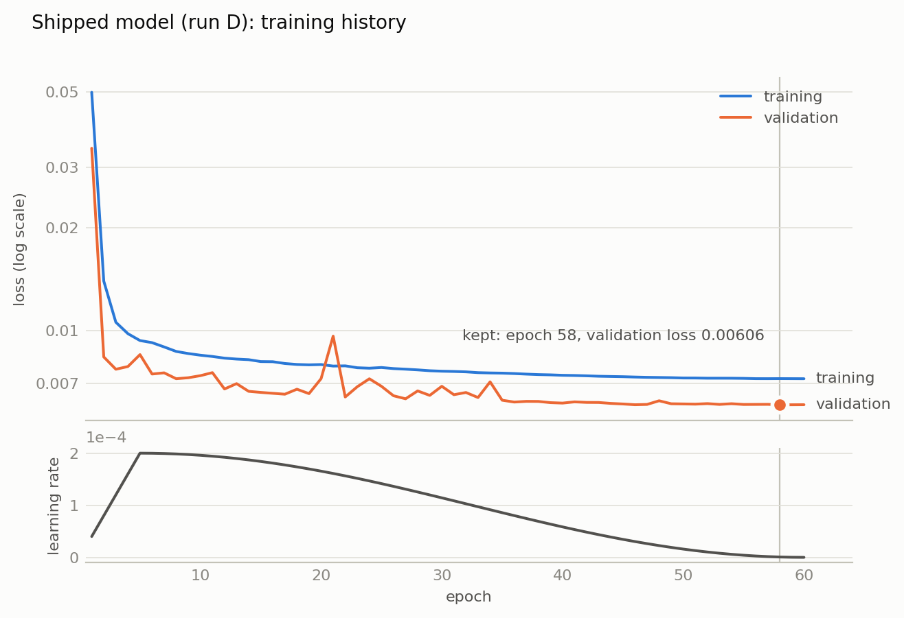
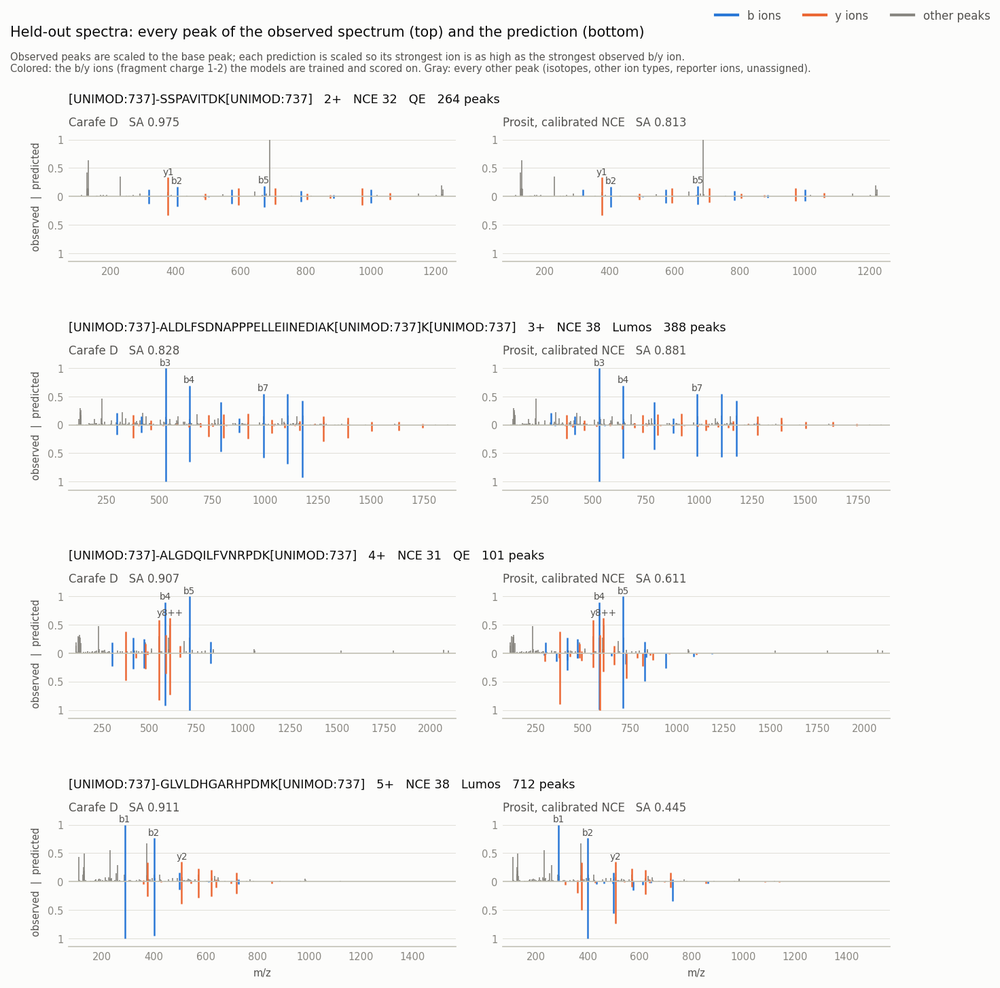

# TMT HCD MS2 model from the NIST CPTAC3 TMT spectral library

This folder builds Carafe's TMT MS2 base model (`models/ms2tmt.pt`, selected with `-ms2_model tmt`)
from a public spectral library, and holds everything needed to reproduce it: data download,
conversion, checks, training, tuning, evaluation and a comparison with Prosit's TMT model. Every
number below was produced by `run_ms2hcd.sh` in one working directory that started empty (the
script resumes where it stopped, and this run was completed in two invocations).

## Data source

| | |
|---|---|
| library | NIST Human CPTAC HCD TMT spectral library, "selected passed best" |
| ProteomeXchange | [PXL000010](https://proteomecentral.proteomexchange.org/?pxid=PXL000010) |
| documentation | <https://chemdata.nist.gov/dokuwiki/doku.php?id=peptidew:lib:human_hcd_tmt> |
| file | `cptac3_tmt_selected_passed_best.msp.tar.gz`, 2,717,409,713 bytes (MSP inside: 7,284,745,279 bytes) |
| URL | <https://chemdata.nist.gov/download/peptide_library/libraries/human/HCD/2022_03_16/cptac3_tmt_selected_passed_best.msp.tar.gz> |
| SHA-256 | `063ac05e057ef5b5745049d7ccba97d69b9d4de6806e96890e98f277b9d02bd3` (`nist_checksum.txt`; the driver refuses a mismatch) |

Compiled by NIST from CPTAC3 data: one spectrum per peptide ion (sequence, modifications, charge),
TMT-labelled human peptides, HCD fragmentation, Orbitrap MS/MS. Please cite the library as the
NIST documentation page asks.

## What the library contains

From `library_stats.py` (full pass, before any filtering):

| property | value |
|---|---|
| spectra | 597,548 |
| unique sequences / modified peptides | 434,227 / 461,153 |
| modifications | TMT6plex 972,879; CAM (carbamidomethyl C) 160,374; Oxidation 38,392 (no others) |
| precursor charge | 1: 188; 2: 242,805; 3: 255,634; 4: 81,527; 5: 15,014; 6: 2,301; 7: 76; 8: 3 |
| NCE | 38: 242,409; 32: 198,676; 30: 62,686; 37: 49,429; 31: 44,348 |
| instrument | Orbitrap Fusion Lumos 354,524; Q Exactive 243,024 (rule below) |
| peptide length | 6-50 |
| clean b/y ions at charge 1-2 per spectrum | median 20 (46% of the b/y matrix); 99.996% of spectra have at least 6, 97.8% at least 10 |
| ambiguous peaks (several annotations) | 2.0% |
| clean backbone ions at fragment charge 1 or 2 | 97.5% (the other 2.5% are at charge 3-6) |

"Clean" means a b or y ion with no neutral loss and no isotope peak, taken from the first
annotation alternative; the per-spectrum count and the matrix (4 columns per backbone position:
b and y at charge 1 and 2) cover fragment charge 1-2 only. The MSP is sorted alphabetically, so a
partial read is not representative.

## Conventions, checked on the data rather than assumed

- **Modification positions are 0-based residue indices**: `(13,C,CAM)` is the C at 1-based 14.
- **The peptide N-terminal label sits at position 0**, carrying the first residue's letter, on every
  spectrum (0 without one). When residue 1 is itself modified, position 0 appears twice: 35,736
  spectra, of which K+TMT6plex 20,323, C+CAM 12,218, M+Oxidation 3,195. The converter takes a TMT
  label at position 0 as the N-terminus wherever it is listed, and any other position-0 entry as
  residue 1 (in this library the label is always listed first).
- **Instrument is not stated per spectrum.** `FTResolution >= 50000` means Lumos, otherwise
  Q Exactive. 93,777 spectra name their instrument in the original file name, and the rule agrees
  on 93,777 of them.
- **NCE** is read from the `@hcd<value>` field of the Thermo filter string.

## Conversion to training data

`msp_to_carafe_training.py --min-charge 1 --max-charge 99 --min-length 1 --max-length 999 --min-fragments 1`
writes the two files Carafe's `ai.py` trains from: `psm_pdv.txt` (one row per spectrum, with NCE and
instrument) and `fragment_intensity_df.tsv` (`b_z1, b_z2, y_z1, y_z2` per backbone position, each
spectrum scaled to a maximum of 1). There is no length or charge filter: every spectrum with at
least one clean b/y ion at charge 1-2 is kept, which scaling to a maximum of 1 needs.

A fragment's intensity is that of its monoisotopic peak, as NIST annotated it (the first alternative
when a peak has several). Isotope peaks, labelled `+i`/`+2i`, are not added; when several peaks carry
the same label, the largest is used; each spectrum is then scaled to a maximum of 1.

| | |
|---|---|
| spectra kept | 597,548 of 597,548 (none has zero clean b/y ions) |
| fragment rows | 7,970,135 |
| NCE | 38: 242,409; 32: 198,676; 30: 62,686; 37: 49,429; 31: 44,348 |
| instrument | Lumos 354,524; QE 243,024 |
| modifications | TMT6plex N-term 597,548; TMT6plex K 375,331; Carbamidomethyl C 160,374; Oxidation M 38,392 |

**Check** (`verify_msp_conversion.py`). A wrong sequence, modification position, fragment row or
charge column would still give a plausible-looking file, so every populated cell of a sample is
compared with the source spectrum: the observed peak m/z against AlphaBase's theoretical m/z for
that cell, and against the ppm error NIST states in its own annotation (a wrong modification
position would shift a TMT-bearing fragment by 229 Da).

| | |
|---|---|
| layout | 597,548 spectra tile 7,970,135 fragment rows contiguously |
| spectra compared | 1,965: the distinct (sequence, charge, NCE) combinations among the first 2,000 rows of `psm_pdv.txt`, the alphabetically first peptides (a row repeating a combination, a modification variant of the same peptide, is skipped) |
| cells checked | 43,754, none without a source peak |
| observed vs AlphaBase m/z | median 1.449 ppm, max 20.026 ppm; 100.00% within 25 ppm |
| vs NIST's own stated ppm | correlation 0.999904; difference median 0.0289 ppm, max 0.1117 ppm; 100.00% within 1 ppm |

## Evaluation protocol

`split_heldout.py` sets aside **5% of the 434,227 peptide sequences** (seed 2024) as a fixed
held-out test set: 29,942 spectra from 21,711 sequences, against 567,606 spectra for training.
Every spectrum of a held-out sequence is held out, whatever its charge, modifications, NCE or
instrument, so no test peptide is seen in training.

The held-out set is only used to score finished models (`evaluate_heldout.py`), never to choose an
epoch or a setting. Within training, `ai.py` keeps its own sequence-disjoint validation split for
choosing the best epoch. Scores are medians over the held-out spectra of Pearson correlation (PCC),
cosine (COS), spectral angle score (SA), Spearman correlation (SPC), plus the share of spectra with
SA > 0.9, computed with Carafe's own `models.py`, each spectrum predicted at its own NCE and
instrument. They are also given for the 28,453 held-out spectra inside Carafe's default library
range (length 7-35, precursor charge 2-4), the peptides a library built with default settings holds.

Reference, the installed generic AlphaPeptDeep model: PCC 0.5628, COS 0.6027, **SA 0.4118**,
SPC 0.7499, SA > 0.9 for 0.0% of spectra (default range: SA 0.4129).

## Training

`train_tmt_ms2.py` calls Carafe's `src/main/resources/py/v2/ai.py` directly (the `carafe` command
line cannot pass the epoch, learning-rate and early-stopping options). Training is transfer learning:
it starts from the generic AlphaPeptDeep MS2 model and trains all of it on the TMT spectra, with a
linear warmup followed by cosine decay of the learning rate to 0, and keeps the weights of the epoch
with the lowest validation loss. Early stopping is off, so every run completes its schedule. Within
the 567,606 training spectra, `ai.py` trains on 562,806 and validates on 2,619 whose sequences it
did not train on; the remaining 2,181 share a sequence with a training spectrum and are used for
neither (ai.py samples the training spectra first and validates on sequences left out). At batch
size 512 that is 1,100 steps per epoch.

### Tuning

Five settings (`tune_configs.tsv`), all starting from the generic model with 5 warmup epochs, plus
a control. Held-out scores are medians over the 29,942 held-out spectra; the last SA column is over
the 28,453 of them inside the default range.

| run | epochs | peak lr | batch | trained on | best epoch | validation loss | PCC | COS | SA | SPC | SA > 0.9 | SA, default range | training |
|---|---|---|---|---|---|---|---|---|---|---|---|---|---|
| A | 30 | 1e-4 | 512 | all | 27 | 0.006182 | 0.9945 | 0.9951 | 0.9367 | 0.9492 | 78.2% | 0.9378 | 18.2 min |
| B | 60 | 1e-4 | 512 | all | 58 | 0.006117 | 0.9949 | 0.9954 | 0.9387 | 0.9508 | 79.3% | 0.9397 | 33.2 min |
| C | 30 | 3e-4 | 512 | all | 29 | 0.006103 | 0.9949 | 0.9954 | 0.9391 | 0.9503 | 79.6% | 0.9401 | 18.3 min |
| **D** | **60** | **2e-4** | **512** | **all** | **58** | **0.006060** | **0.9951** | **0.9956** | **0.9400** | **0.9520** | **80.0%** | **0.9410** | **33.3 min** |
| E | 30 | 1e-4 | 256 | all | 29 | 0.006171 | 0.9947 | 0.9953 | 0.9380 | 0.9497 | 78.7% | 0.9391 | 20.9 min |
| D0 | 60 | 2e-4 | 512 | default range | 56 | (0.006508) | 0.9950 | 0.9955 | 0.9394 | 0.9514 | 78.2% | 0.9409 | 30.6 min |
| generic | - | - | - | - | - | - | 0.5628 | 0.6027 | 0.4118 | 0.7499 | 0.0% | 0.4129 | - |

**Run D was selected on validation loss**, the lowest of A-E; it is also the best of them on every
held-out metric, so the choice did not depend on the held-out set. Its settings (60 epochs, peak
learning rate 2e-4) combine the two changes that each helped on their own: a longer schedule (B) and
a higher learning rate (C). The gain over the first settings (A) is modest, +0.0033 SA and 1.8
points more spectra above SA 0.9. Training loss is above validation loss in 59 of the 60 epochs,
which is expected because dropout is active only while training; the validation loss, measured on
2,619 spectra, is noisier and rises above it once, at epoch 21.

<picture>
  <source media="(prefers-color-scheme: dark)" srcset="loss_curve_dark.png">
  
</picture>

`plot_loss_curve.py --run sweep/D --out loss_curve --title "Shipped model (run D): training history"`
draws this figure from the run's `ms2_history.tsv` (step 9 of `run_ms2hcd.sh`). "Validation" is
`ai.py`'s internal split, not the held-out test set.

### Why train on every spectrum (control D0)

D0 uses D's settings but trains only on the 539,221 training spectra inside the default range
(`ai.py` trains on 534,421 and validates on 2,653 of them). Its validation loss is measured on a
different validation set, so it is not compared with the others. On the held-out set (the rows
below the first are over every held-out spectrum of that charge or length, inside the default range
or not):

| held-out spectra | count | median SA, D (all spectra) | median SA, D0 (default range only) |
|---|---|---|---|
| default range (length 7-35, charge 2-4) | 28,453 | 0.9410 | 0.9409 |
| precursor charge 2 / 3 / 4 | 12,171 / 12,817 / 4,085 | 0.9460 / 0.9416 / 0.9219 | 0.9458 / 0.9416 / 0.9209 |
| precursor charge 5 | 743 | 0.9040 | 0.7666 |
| precursor charge 6 | 114 | 0.8879 | 0.6550 |
| precursor charge 1 / 7 | 7 / 5 | 0.9334 / 0.8842 | 0.6680 / 0.5481 |
| length above 35 | 348 | 0.8994 | 0.8459 |
| length below 7 | 406 | 0.9542 | 0.9469 |

Training on the spectra outside the default range costs nothing inside it and makes
the model usable beyond it, for example with a wider `-max_pep_charge` or `-maxLength`.

### Shipped model

`models/ms2tmt.pt` is run D's `ms2_model.pt`, unchanged: 16,192,895 bytes, SHA-256
`3460e5b6b0ed3070fd8633e5b637dced8df46ba2645b721a05b38c020314ccb7`. It was trained on the training
part only, and being byte-identical to run D's model, run D's held-out scores are its scores:
PCC 0.9951, COS 0.9956, SA 0.9400, SPC 0.9520, 80.0% of spectra above SA 0.9.

| held-out spectra at | NCE 30 | NCE 31 | NCE 32 | NCE 37 | NCE 38 | Lumos | Q Exactive |
|---|---|---|---|---|---|---|---|
| median SA | 0.9464 | 0.9248 | 0.9512 | 0.9453 | 0.9284 | 0.9343 | 0.9475 |

**Predicting at the wrong NCE costs accuracy.** Held-out spectra predicted at one fixed NCE instead
of their own (`evaluate_heldout.py --nce`):

| predicted at | median SA | on NCE 30-32 spectra | on NCE 37-38 spectra |
|---|---|---|---|
| each spectrum's own NCE | 0.9400 | 0.9248-0.9512 | 0.9284-0.9453 |
| NCE 32 | 0.8771 | 0.9134-0.9512 | 0.7743-0.7873 |
| NCE 38 | 0.8698 | 0.7636-0.8090 | 0.9284-0.9296 |
| NCE 30 | 0.8675 | 0.9245-0.9464 | 0.7552-0.7612 |
| NCE 27 (Carafe's default) | 0.8574 | 0.8883-0.9437 | 0.7593-0.7614 |

The model file is not kept in git. The build copies `models/ms2tmt.pt` into the distribution
(`target/carafe-<version>/models/`), where `-ms2_model tmt` finds it, and it is published as a
release asset.

## Comparison with Prosit TMT

`compare_prosit_tmt.py` scores Prosit_2020_intensity_TMT, served by the public
[Koina](https://koina.wilhelmlab.org) server, on the same held-out set (step 10). Koina's Prosit
takes peptides of up to 30 residues at precursor charge 1-6, so all models are compared on the
29,020 held-out spectra inside that range (it accepted the shortest peptides too, including 406
spectra of 6-residue peptides). Every model is scored on the same four columns (b and y at
fragment charge 1-2, the ions the held-out set holds); Prosit's fragment-charge-3 outputs are
dropped. SA and COS are computed exactly as above; PCC and SPC here leave out the all-zero
neutral-loss columns that `evaluate_heldout.py` also counts, so they differ slightly from the
tables above.

Prosit expects a calibrated collision energy, which need not equal the NCE recorded in the file. It
is therefore scored twice: at each spectrum's recorded NCE, and at the recorded NCE plus one offset
per instrument, chosen from -6 to +6 by median SA on 1,000 training spectra per instrument (never on
the held-out set):

| NCE offset | -6 | -5 | -4 | -3 | -2 | -1 | 0 | +1 | +2 | +3 | +4 | +5 | +6 |
|---|---|---|---|---|---|---|---|---|---|---|---|---|---|
| Lumos | 0.6617 | 0.6773 | 0.6989 | 0.7272 | 0.7539 | 0.7730 | 0.7845 | 0.7975 | **0.8051** | 0.7964 | 0.7805 | 0.7668 | 0.7494 |
| Q Exactive | 0.5625 | 0.5784 | 0.5964 | 0.6171 | 0.6460 | 0.6695 | 0.6869 | 0.7058 | 0.7248 | 0.7564 | 0.7879 | 0.8047 | **0.8070** |

For Q Exactive the best offset is at the edge of the searched range, still rising slightly, so a
larger offset might score a little higher; the Q Exactive figures for calibrated Prosit below may
slightly understate it.

On the held-out spectra (median SA; Carafe models at the recorded NCE, which is what they were
trained on):

| model | PCC | COS | SA | SPC | SA > 0.9 | SA, Lumos | SA, Q Exactive |
|---|---|---|---|---|---|---|---|
| Prosit, recorded NCE | 0.8999 | 0.9212 | 0.7456 | 0.7254 | 2.5% | 0.7831 | 0.6913 |
| Prosit, calibrated NCE (Lumos +2, QE +6) | 0.9407 | 0.9523 | 0.8026 | 0.7369 | 7.2% | 0.8040 | 0.8007 |
| generic AlphaPeptDeep | 0.5116 | 0.6025 | 0.4116 | 0.6976 | 0.0% | 0.3990 | 0.4318 |
| **shipped model (run D)** | **0.9946** | **0.9957** | **0.9410** | **0.9572** | **80.9%** | **0.9355** | **0.9480** |

| precursor charge | 2 | 3 | 4 | 5 | 6 |
|---|---|---|---|---|---|
| spectra | 12,171 | 12,638 | 3,629 | 521 | 54 |
| Prosit, calibrated NCE | 0.7933 | 0.8222 | 0.7609 | 0.6744 | 0.5661 |
| shipped model (run D) | 0.9460 | 0.9420 | 0.9244 | 0.9070 | 0.8696 |

(The 7 held-out spectra at precursor charge 1 are left out of this table.)

The shipped model was trained on spectra from the same library (not on these peptides), while
Prosit was trained on other data, so part of the gap is the match between training and test data
rather than the model.

Four held-out spectra, one per precursor charge 2-5, picked at random with a fixed seed. The top of
each panel is the observed spectrum with every peak from the library; the bottom is the prediction:

<picture>
  <source media="(prefers-color-scheme: dark)" srcset="mirror_dark.png">
  
</picture>

Colored peaks are the b/y ions at fragment charge 1-2 that the models are trained and scored on;
gray peaks are everything else in the spectrum (isotopes, other ion types, reporter ions,
unassigned). Observed peaks are scaled to the base peak, and each prediction so that its strongest
ion is as high as the strongest observed b/y ion. The full peak lists are read from the MSP; each
plotted spectrum is matched to its library entry by sequence, charge, modifications, NCE and
instrument, and its b/y ions are checked against the held-out row.

## Hardware and software

From `environment.py`:

| | |
|---|---|
| OS | Windows 11 (build 26200) |
| CPU | Intel Core Ultra 7 265K, 20 logical cores |
| RAM | 127 GiB |
| GPU | NVIDIA RTX 5000 Ada Generation, 30 GiB |
| NVIDIA driver | 595.95 |
| CUDA (PyTorch build) / cuDNN | 12.1 / 9.1.0 |
| Python | 3.9.18 |
| PyTorch | 2.5.1+cu121 |
| peptdeep / alphabase | 1.1.0 / 1.2.1 |
| numpy / pandas / scipy / pyarrow | 1.26.4 / 2.2.3 / 1.13.1 / 21.0.0 |

Wall-clock time of each step: download, check and unpack 2 min (the download 54 s, about
48 MiB/s), library statistics 2.5 min, conversion 3 min, check 6 s, split 20 s, reference
evaluation 11 s; training as listed above (the whole sweep, including scoring, 2 h 38 min);
predicting and scoring the held-out set takes 2-3 s per model; the fixed-NCE scores and the figure
for the selected run 53 s; the Prosit comparison about 10 min, almost all of it waiting for Koina
(calibration 2 min, held-out predictions 7 min, four requests at a time), which depends on the
load of the public server.

## Reproduce

```bash
WORK=/path/to/workdir PY=/path/to/python ./run_ms2hcd.sh     # ~10 GB in $WORK
```

`PY` is a Python with PyTorch, peptdeep and alphabase (the environment Carafe uses for its models)
and matplotlib (for the figures). Step 10 sends the held-out peptides and 2,000 training peptides
(all public library entries) to the public Koina server, so it needs internet access. Every step that takes more than a few seconds
is skipped when its output is complete, so an interrupted run resumes; recording the environment,
drawing the loss curve and the model checksum are quick and always re-run. `SWEEP_ONLY=A` trains
only some rows of `tune_configs.tsv`; `SELECTED=D` names the run scored at fixed NCEs, plotted and
compared with Prosit (the default); `DEVICE=cpu` works without a GPU but is much slower.

On Windows, a CUDA process started seconds after another one exits occasionally died at start-up
with a native error (0xC0000409) and no Python traceback. `run_sweep.py` therefore waits 15 s
before each training and scoring step (included in the training times above) and retries a step
once after that error, keeping the crashed attempt's log. A retried step starts from scratch with
the same data and seeds, so it redoes the same work.

| file | step |
|---|---|
| `run_ms2hcd.sh` | runs everything below in order |
| `nist_checksum.txt` | expected SHA-256 of the archive |
| `library_stats.py` | the library as distributed |
| `msp_to_carafe_training.py` | MSP to `psm_pdv.txt` + `fragment_intensity_df.tsv` |
| `verify_msp_conversion.py` | checks every sampled intensity landed in the right cell |
| `split_heldout.py` | fixed sequence-disjoint held-out test set, and its default-range subset |
| `train_tmt_ms2.py` | trains one model with `ai.py` and lays out the model directory |
| `tune_configs.tsv`, `run_sweep.py` | the tuning runs, with timing and held-out scores |
| `evaluate_heldout.py` | scores any model on the held-out set, optionally at one fixed NCE |
| `plot_loss_curve.py` | draws `loss_curve_light.png` / `loss_curve_dark.png` from a run's history |
| `compare_prosit_tmt.py` | Prosit TMT via Koina: NCE calibration, held-out scores, `mirror_light.png` / `mirror_dark.png` |
| `environment.py` | records hardware and software |
| `test_ms2hcd_tools.py` | unit tests (`python -m pytest test_ms2hcd_tools.py`) |

## Limitations

- **HCD, Orbitrap MS/MS only**, at NCE 30, 31, 32, 37 and 38. Predictions at other energies are
  extrapolations; Carafe warns when the bundled model is used outside 30-38.
- **Fragment intensities only.** The library has no retention times, so no TMT retention-time
  model can be trained from it.
- **Selected spectra.** NIST keeps the best-scoring spectrum per peptide ion, which favours clean
  spectra.
- **TMT6plex/TMT11 data.** TMTpro peptides are predicted by the same model with TMTpro masses.
- **Few very highly charged spectra.** Precursor charge 5 and above is 2.9% of the library (17,394
  spectra), so the model is weaker there (median SA 0.8879 at charge 6).
- Fragment ions above charge 2 (2.5% of the library's clean backbone ions), neutral losses, a ions,
  internal and immonium ions and reporter ions are not modelled.
